<p align="center">
  
</p>

<h1 align="center">Switchly</h1>

<p align="center">
  One-tap Quick Settings tiles for the Android settings that do not have one.
</p>

<p align="center">
  <a href="https://github.com/4bhisheksharma/switchly/releases/latest"></a>
  
  <a href="LICENSE"></a>
</p>

<p align="center">
  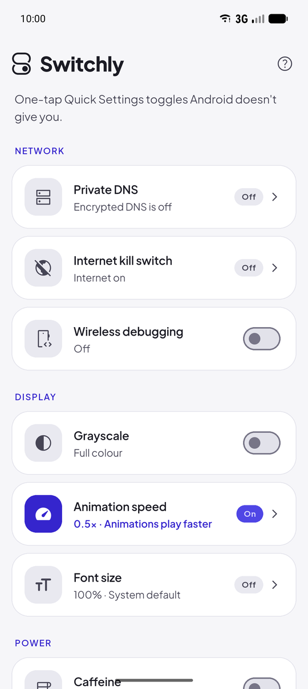
  &nbsp;
  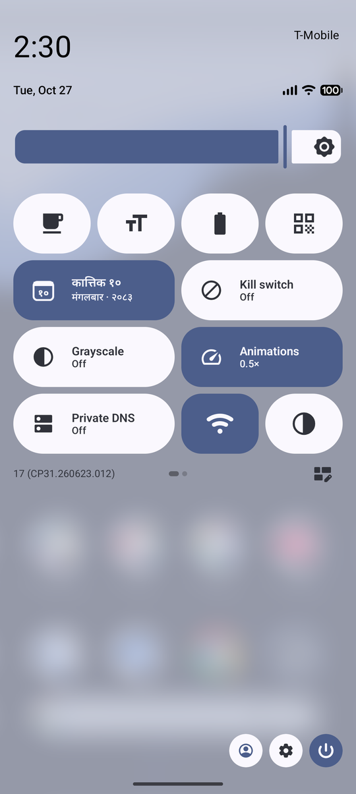
  &nbsp;
  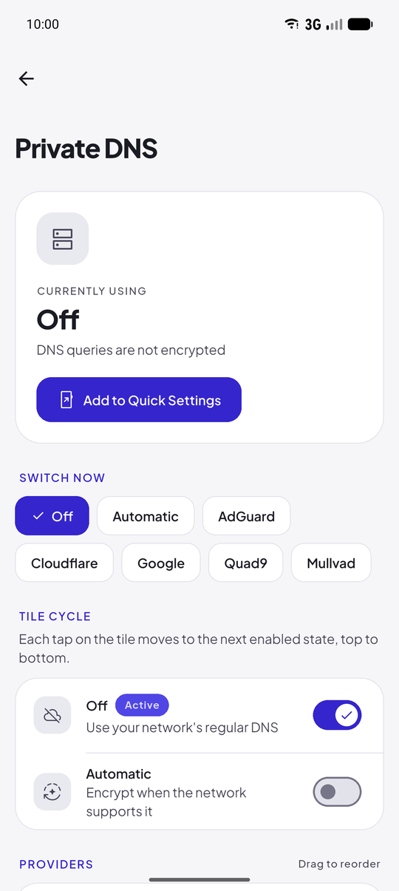
</p>

---

## What is Switchly?

Android's Quick Settings panel (the panel you pull down from the top of the screen) has tiles for Wi-Fi, Bluetooth and a few other things. Many useful settings are missing from it and are buried several screens deep in the Settings app, or inside Developer options.

Switchly adds those missing settings as Quick Settings tiles. Each tile does one job with a single tap, from any app, and many of them work from the lock screen. The Switchly app itself is where you choose how each tile behaves.

Switchly is fully offline. It does not request the internet permission, contains no analytics or tracking, and never sends data anywhere.

## Features

### Network

| Tile | What it does |
| --- | --- |
| **Private DNS** | Switches encrypted DNS between Off and providers such as AdGuard, Cloudflare, Google, Quad9 and Mullvad. Each tap moves to the next provider. You can add your own providers and choose the order. |
| **Internet kill switch** | Blocks all internet traffic instantly, with an optional list of apps that stay online. It works through Android's local VPN feature; traffic is dropped on the phone and never sent or inspected. |
| **Wireless debugging** | Turns ADB over Wi-Fi on or off and shows the address to connect to (`ip:port`). Requires Android 11 or newer. |

### Display

| Tile | What it does |
| --- | --- |
| **Grayscale** | Turns the screen black and white to reduce distraction. Your previous colour correction setting is restored when you turn it off. |
| **Animation speed** | Cycles the system animation speed, for example Off, 0.5x and 1x, to make the phone feel faster. |
| **Font size** | Cycles the system text size, for example 100%, 130% and 150%. Useful before handing the phone to someone who needs larger text. |

### Power

| Tile | What it does |
| --- | --- |
| **Caffeine** | Keeps the screen on while you read, follow directions or present. Each tap selects a longer duration (5, 15, 30, 60 minutes, no limit), and the next tap after the last one turns it off. It also turns off when the screen is locked, unless you change that. |
| **Battery** | Shows the battery level, temperature and live charging power in watts directly on the tile. |

### Everyday

| Tile | What it does |
| --- | --- |
| **Nepali date** | Shows today's Bikram Sambat (BS) date on the tile, in Nepali or English script. The app includes a full BS calendar and an AD to BS converter. |
| **Payment QR** | Shows your saved payment QR codes (eSewa, Khalti, Fonepay, bank and others) full screen at maximum brightness, without opening any other app. Works from the lock screen. |
| **Quick texts** | Saves text you type often, such as an address, account number or a standard reply. Tap the tile, pick a text, and it is copied to the clipboard. |
| **Profiles** | Applies several settings at once, for example "Focus" = AdGuard DNS + Grayscale + faster animations. A "Restore" option puts everything back as it was. |

Long-press any Switchly tile in Quick Settings to open its settings screen in the app.

## Screenshots

<p align="center">
  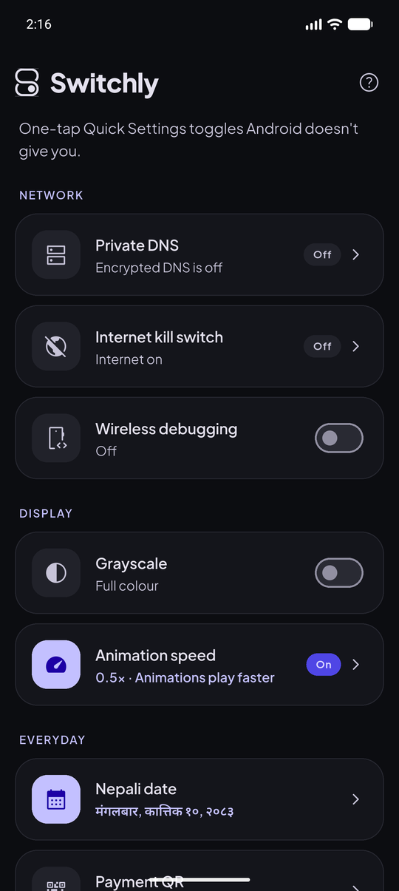
  &nbsp;
  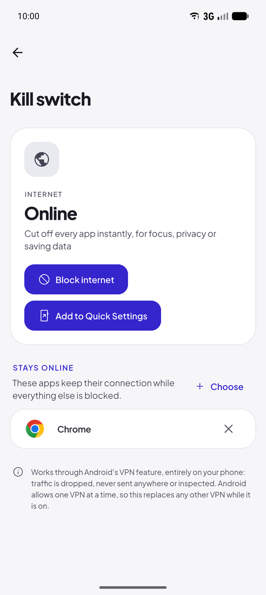
  &nbsp;
  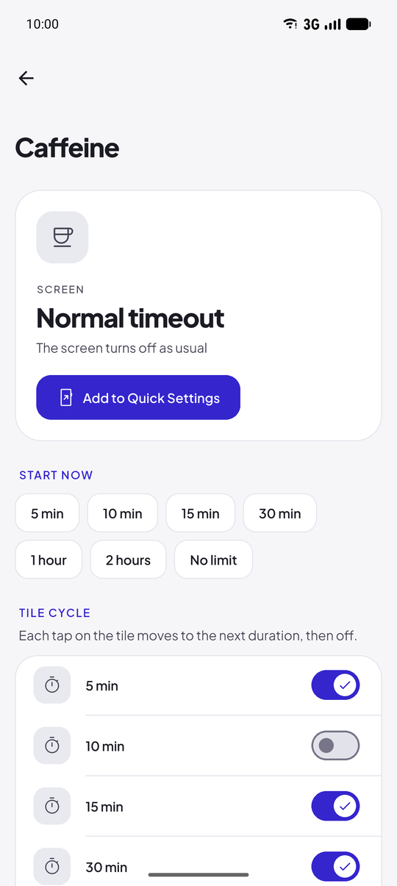
  &nbsp;
  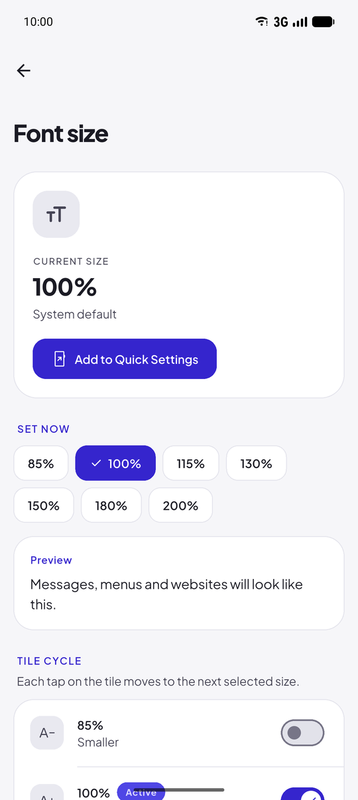
</p>

<p align="center">
  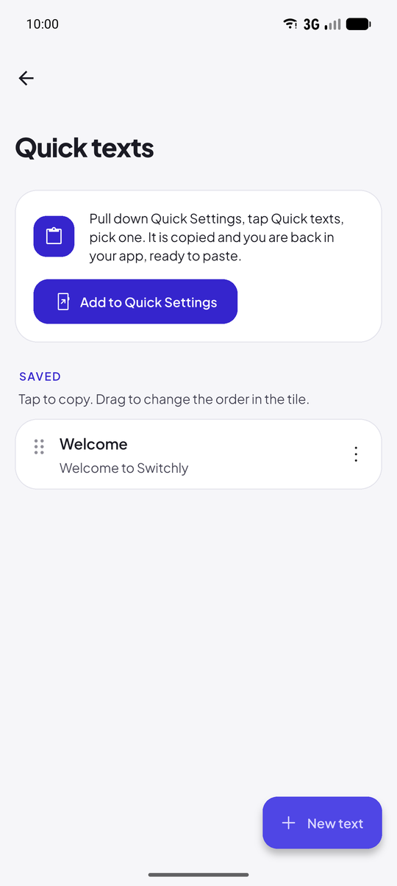
  &nbsp;
  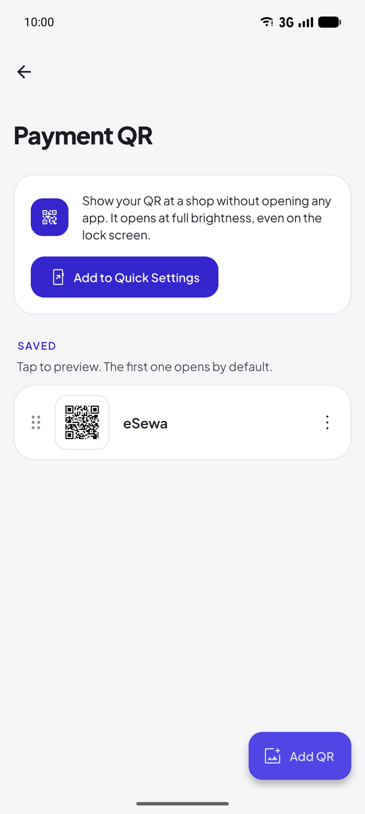
  &nbsp;
  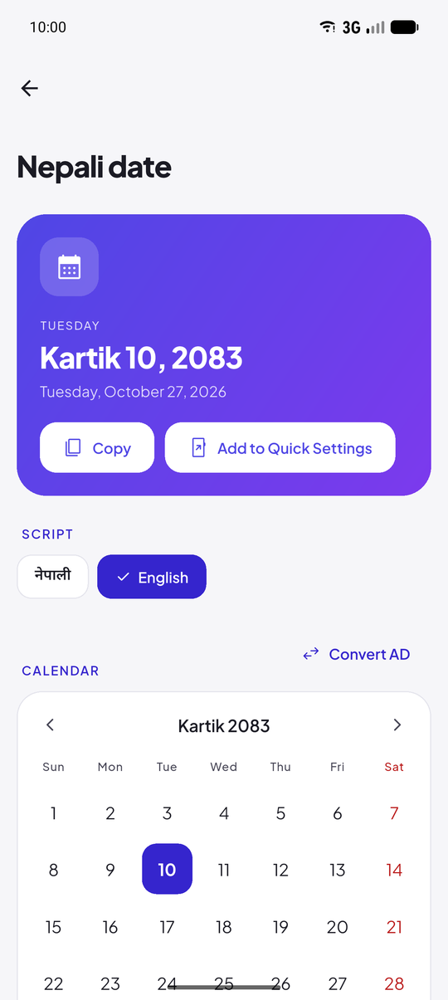
  &nbsp;
  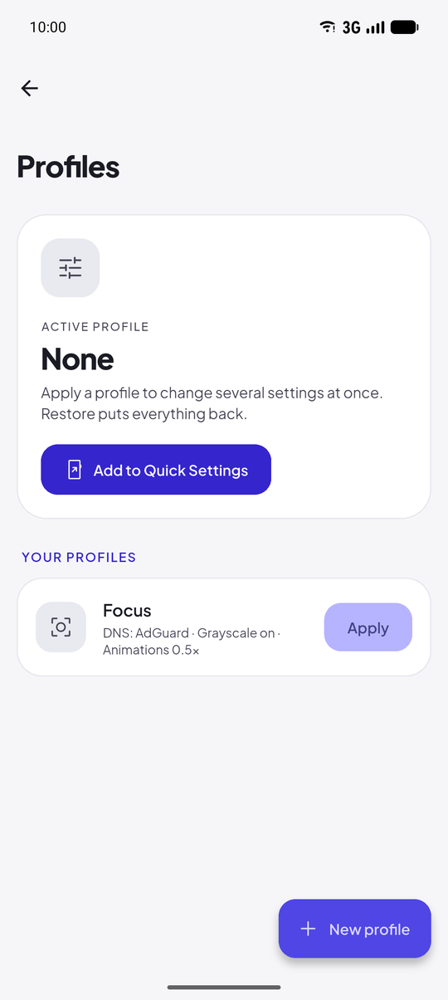
</p>

<p align="center">
  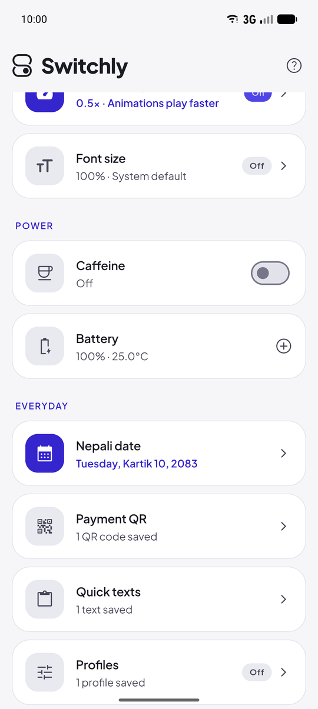
  &nbsp;
  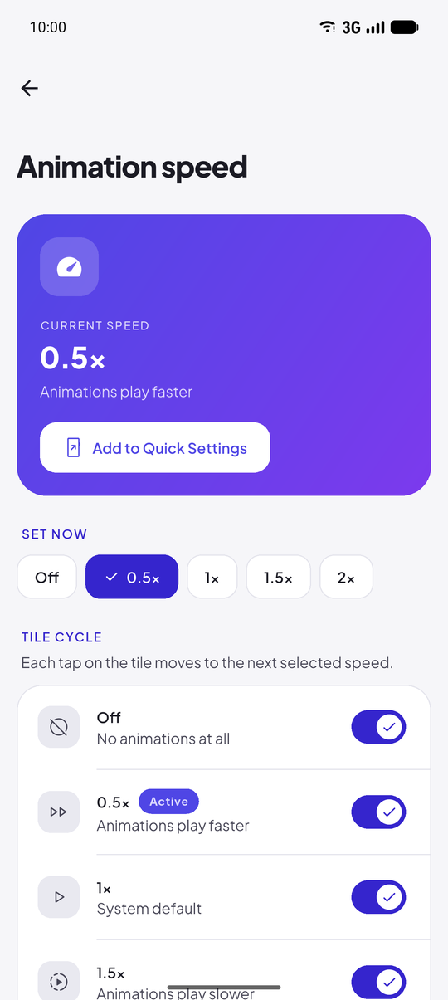
</p>

## Installation

### Requirements

- An Android phone running Android 10 or newer.
- For some tiles, a computer with ADB for a one-time setup (see below).

### Download

1. Open the [latest release](https://github.com/4bhisheksharma/switchly/releases/latest) on GitHub.
2. Under **Assets**, download the `.apk` file.
3. Open the downloaded file on your phone and tap **Install**. If Android asks, allow your browser or file manager to install unknown apps.

To update, download and install the newer APK from the releases page. Your settings are kept.

## Getting started

### 1. Grant the one-time permission

Several tiles change system settings, which Android only allows after a special permission (`WRITE_SECURE_SETTINGS`) is granted once from a computer. This permission cannot be requested through a normal pop-up. It stays granted across reboots and app updates, and is only removed if you uninstall the app.

The tiles that need it are Private DNS, Wireless debugging, Grayscale, Animation speed, Font size and Profiles. All other tiles work without it.

1. On your phone, open **Settings > About phone** and tap **Build number** seven times to enable Developer options.
2. Open **Settings > System > Developer options** and turn on **USB debugging**.
3. Install [Android platform tools](https://developer.android.com/tools/releases/platform-tools) (ADB) on your computer.
4. Connect the phone with a USB cable, allow the debugging prompt on the phone, and run:

   ```sh
   adb shell pm grant app.utils.switchly android.permission.WRITE_SECURE_SETTINGS
   ```

5. Return to Switchly. It detects the permission automatically.

The command only grants permission to change settings. It does not root the phone or give the app any other access. You may turn USB debugging off again afterwards.

#### If the command fails

**`adb: more than one device/emulator`**

ADB can see more than one device, for example your phone and an emulator. Run `adb devices` to list them, then send the command to your phone by its serial number:

```sh
adb devices
adb -s <serial> shell pm grant app.utils.switchly android.permission.WRITE_SECURE_SETTINGS
```

Alternatively, use `adb -d shell ...` to target the only device connected by USB, or close the emulator.

**`SecurityException: ... has android.permission.GRANT_RUNTIME_PERMISSIONS`**

Some manufacturers block this command until an additional developer setting is enabled.

- **Xiaomi, Redmi and POCO (MIUI and HyperOS):** in **Settings > Additional settings > Developer options**, turn on **USB debugging (Security settings)**. This option requires a SIM card and a signed-in Mi account. Then **restart the phone**, or turn **USB debugging** off and on again and reconnect the cable. The setting only takes effect for a new debugging connection, so running the command again immediately after enabling it will still fail.
- **OPPO, Realme and OnePlus (ColorOS and OxygenOS):** in **Developer options**, turn on **Disable permission monitoring**, then disconnect and reconnect the cable.

Run the command again afterwards. When it succeeds, it prints nothing. On Xiaomi devices, leave **USB debugging (Security settings)** turned on; on some versions, turning it off removes the permission again.

After these changes it will be best to restart your phone once to align the changes perfectly.

**Rooted devices:** tap **Set up now** on the Switchly home screen and choose **Grant with root** instead of using a computer.

### 2. Add tiles to Quick Settings

On Android 13 and newer, tap **Add to Quick Settings** on any tile's screen in the app and confirm.

On any Android version, you can also add tiles manually:

1. Swipe down twice from the top of the screen to open Quick Settings.
2. Tap the edit (pencil) button.
3. Drag the Switchly tiles you want into the active area.

### 3. Customise

Open a tile's screen in the app (or long-press the tile) to choose what each tap does. For example, choose which DNS providers the Private DNS tile cycles through, which apps stay online during the kill switch, or which durations Caffeine offers.

## Permissions

Switchly only declares permissions that a feature actively uses.

| Permission | Why it is needed |
| --- | --- |
| `WRITE_SECURE_SETTINGS` | Change Private DNS, grayscale, animation speed, font size and wireless debugging. Granted once over ADB. |
| `ACCESS_NETWORK_STATE` | Read the Wi-Fi IP address shown by the Wireless debugging tile. |
| `WAKE_LOCK`, `FOREGROUND_SERVICE`, `FOREGROUND_SERVICE_SPECIAL_USE` | Keep the screen on while Caffeine is active. |

There is no `INTERNET` permission. The kill switch uses Android's VPN feature, which Android asks you to approve the first time; no traffic leaves the phone through it.

## Frequently asked questions

**A tile says "Tap to set up".**
The one-time permission has not been granted yet. Tap the tile, or follow [Grant the one-time permission](#1-grant-the-one-time-permission).

**The ADB command shows an error.**
See [If the command fails](#if-the-command-fails). On Xiaomi, Redmi, POCO, OPPO, Realme and OnePlus phones, an extra developer setting is required.

**How do I know what a small tile just did?**
Tiles show their current value in the tile name itself, for example "AdGuard" for Private DNS, "Anim 0.5x" for Animation speed or "Font 130%" for Font size. This name is visible even when a tile is shown at its small size, including in Control Center on Xiaomi phones.

**Why does the kill switch replace my VPN?**
Android allows only one VPN at a time. While the kill switch is on, any other VPN app is disconnected.

**Will my phone manufacturer's settings work?**
Switchly uses standard Android settings and is tested on stock Android (Pixel). Some manufacturers modify these settings, so individual tiles may behave differently on their devices. Please open an issue if a tile does not work on your phone.

**The battery wattage looks wrong.**
Some manufacturers report charging current in non-standard units. Switchly corrects the common cases, but values may be inaccurate on some devices.

## Building from source

Switchly is built with Flutter (user interface) and Kotlin (Quick Settings tiles and system integration).

```sh
git clone https://github.com/4bhisheksharma/switchly.git
cd switchly
flutter pub get
flutter build apk --release
```

The APK is written to `build/app/outputs/flutter-apk/app-release.apk`.

Use a release build when testing tile responsiveness. Debug builds are considerably slower on Android.

## Contributing

Bug reports, device compatibility reports and pull requests are welcome. Please open an issue to discuss larger changes before starting work on them.

## License

Copyright (C) 2026 Abhishek Sharma

Switchly is free software: you can redistribute it and/or modify it under the terms of the GNU General Public License as published by the Free Software Foundation, either version 3 of the License, or (at your option) any later version.

Switchly is distributed in the hope that it will be useful, but WITHOUT ANY WARRANTY; without even the implied warranty of MERCHANTABILITY or FITNESS FOR A PARTICULAR PURPOSE. See the [LICENSE](LICENSE) file for the full text.
